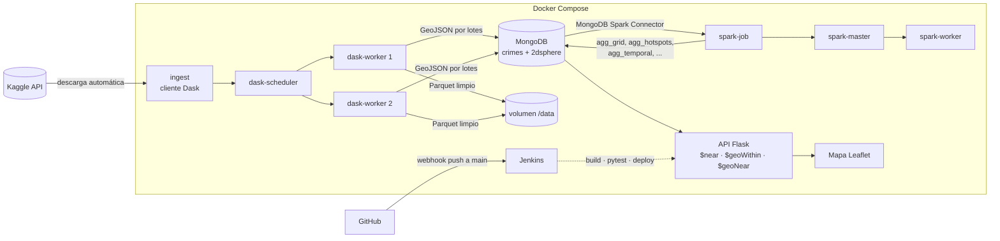

# Procesamiento y consulta de datos geoespaciales con despliegue continuo

Sistema completo que descarga un dataset geoespacial de Kaggle, lo limpia con **Dask**, lo guarda en **MongoDB** como GeoJSON con índice `2dsphere`, calcula agregaciones espaciales y temporales con **Spark**, lo expone con una **API Flask** (más un mapa Leaflet) y se construye, prueba y despliega automáticamente con **Jenkins** cada vez que hay cambios en `main`.

Dataset por defecto: [Crimes in Chicago](https://www.kaggle.com/datasets/currie32/crimes-in-chicago), archivo `Chicago_Crimes_2012_to_2017.csv` (~1,45 millones de registros con latitud y longitud).

## Arquitectura



| Servicio | Imagen | Puerto | Función |
|---|---|---|---|
| `mongo` | mongo:7.0 | 27018 (solo localhost) | Datos en GeoJSON con índice 2dsphere |
| `spark-master` / `spark-worker` | apache/spark 3.5.3 + conector MongoDB 10.4 | 8081 (UI) | Clúster Spark standalone |
| `spark-job` | misma de Spark | 4040 mientras corre | Agregaciones (one-shot) |
| `dask-scheduler` / `dask-worker` ×2 | python 3.11 + dask | 8787 (dashboard) | Clúster Dask |
| `ingest` | misma de Dask | — | Kaggle → limpieza → MongoDB (one-shot) |
| `api` | python 3.11 + Flask/gunicorn | 5000 | API de producción + mapa |
| `api-staging` | misma de la API | 5001 | Versión candidata que prueba Jenkins (perfil `ci`) |
| `jenkins` | jenkins lts + Docker CLI | 8080 | CI/CD, preconfigurado como código |

## Inicio rápido

Requisitos: Docker Desktop (o Docker Engine + Compose v2) con **al menos 6 GB de RAM asignados**, Git y una cuenta de Kaggle.

```bash
git clone https://github.com/USUARIO/REPO.git
cd REPO
cp .env.example .env        # en Windows: copy .env.example .env
# Editar .env: KAGGLE_USERNAME, KAGGLE_KEY, JENKINS_ADMIN_PASSWORD y GIT_REPO_URL
docker compose up -d --build
```

Ese único comando construye las imágenes, levanta los servicios, ejecuta la ingesta (descarga de Kaggle, limpieza con Dask y carga a MongoDB) y luego el trabajo de Spark. La primera vez tarda entre 10 y 20 minutos según el equipo y la conexión. Para seguir el avance:

```bash
docker compose logs -f ingest spark-job
```

Cuando termine:

| Qué | URL |
|---|---|
| Mapa | http://localhost:5000 |
| API (salud y versión) | http://localhost:5000/health |
| Jenkins | http://localhost:8080 (usuario y clave del `.env`) |
| Spark master | http://localhost:8081 |
| Dashboard de Dask | http://localhost:8787 |
| MongoDB Compass | `mongodb://localhost:27018` |

El token de Kaggle se obtiene en Kaggle → *Settings* → *API* → *Create New Token*; el archivo `kaggle.json` trae `username` y `key`. Ese valor solo vive en el `.env` (ignorado por Git) y en la credencial `kaggle-api` de Jenkins.

Si el equipo tiene poca memoria, bajar `SPARK_WORKER_MEMORY`, `DASK_WORKER_MEMORY` o usar `SAMPLE_ROWS=1000000` en el `.env`.

## Ingesta y limpieza (Dask)

`ingest/ingest.py`:

1. Descarga el archivo con la CLI de Kaggle (`kaggle datasets download`) usando las variables `KAGGLE_USERNAME` y `KAGGLE_KEY`.
2. Lee el CSV en particiones de 64 MB con `dask.dataframe.read_csv` repartidas entre los workers.
3. Descarta registros con coordenadas nulas, fuera de rango (lat ±90, lon ±180), fuera del área de estudio (`BBOX`, Chicago con margen; elimina, por ejemplo, los puntos en 0,0 o en otros estados), con fecha no interpretable, sin ID, y los duplicados por ID.
4. Escribe el resultado limpio en Parquet (`/data/clean`, también lo usa el benchmark).
5. Cada worker inserta su partición en MongoDB con `insert_many(ordered=False)` en lotes de 5000 documentos. El `_id` es el ID original, así que re-ejecutar la carga no duplica datos.
6. Crea los índices `location_2dsphere`, `date_1` y `category_date`.

Cada documento queda así:

```json
{
  "_id": 10508693,
  "location": { "type": "Point", "coordinates": [-87.6688, 41.8645] },
  "date": "2016-05-03T23:40:00Z",
  "year": 2016,
  "category": "BATTERY",
  "description": "DOMESTIC BATTERY SIMPLE",
  "location_description": "APARTMENT",
  "arrest": true, "domestic": true, "district": 10, "community_area": 29
}
```

El reporte de limpieza (conteos por regla y tiempos) queda en la colección `ingest_runs` y en `/data/reports/cleaning.json`:

```bash
docker compose exec mongo mongosh geo --quiet --eval 'db.ingest_runs.find().sort({finished_at:-1}).limit(1)'
```

Para cambiar de dataset basta con las variables `KAGGLE_DATASET`, `KAGGLE_FILE`, `LAT_COL`, `LON_COL`, `DATE_COL`, `DATE_FORMAT`, `CATEGORY_COL`, `ID_COL`, `EXTRA_COLS` y `BBOX`.

## Procesamiento distribuido (Spark)

`spark/jobs/aggregations.py` lee `crimes` desde MongoDB con el MongoDB Spark Connector y escribe:

| Colección | Contenido |
|---|---|
| `agg_grid` | Conteo por celda de una grilla de `GRID_SIZE` grados (0,005° ≈ 550 × 410 m), con el polígono GeoJSON de la celda, su centro, densidad por km², tasa de arresto y categoría más frecuente |
| `agg_hotspots` | Celdas con conteo ≥ percentil 99, con ranking y z-score |
| `agg_temporal` | Conteos por hora, día de la semana (1 = domingo), mes y año |
| `agg_category_hour` | Categoría × hora para las 10 categorías más frecuentes |
| `agg_types` | Conteo, participación y tasa de arresto por categoría |
| `agg_meta` | Parámetros, totales y tiempo de la última corrida |

Para recalcular a mano: `docker compose run --rm --no-deps -e FORCE_SPARK=true spark-job`.

## API

| Método | Ruta | Parámetros | Operador |
|---|---|---|---|
| GET | `/api/crimes/near` | `lat`, `lon`, `radius` (m, por defecto 1000, máx. 50 000), `limit` | `$near` |
| POST | `/api/crimes/within` | cuerpo: Polygon, MultiPolygon o Feature GeoJSON; `?count=true` agrega el total | `$geoWithin` |
| GET | `/api/crimes/summary` | `lat`, `lon`, `radius`, `group_by` (`category`, `location_description`, `district`, `year`, `arrest`, `domestic`) | agregación `$geoNear` |
| GET | `/api/stats/grid` | `min_count`, `limit` | resultados de Spark |
| GET | `/api/stats/hotspots` | `limit` | resultados de Spark |
| GET | `/api/stats/temporal` | `dimension` = `hour`, `day_of_week`, `month`, `year` | resultados de Spark |
| GET | `/api/stats/types` | `limit` | resultados de Spark |
| GET | `/api/stats/meta` | — | resultados de Spark |
| GET | `/health`, `/api/meta` | — | estado, versión desplegada |

Filtros opcionales en las consultas de registros: `category`, `from` y `to` (AAAA-MM-DD), `year`, `arrest`. Las respuestas de registros son `FeatureCollection` GeoJSON y llevan la cabecera `X-Response-Time-ms`.

```bash
# registros a 500 m del Loop
curl "http://localhost:5000/api/crimes/near?lat=41.8781&lon=-87.6298&radius=500&limit=20"

# dentro de un polígono (el orden es [lon, lat])
curl -X POST "http://localhost:5000/api/crimes/within?count=true" \
  -H "Content-Type: application/json" \
  -d '{"type":"Polygon","coordinates":[[[-87.64,41.87],[-87.62,41.87],[-87.62,41.89],[-87.64,41.89],[-87.64,41.87]]]}'

# resumen por categoría a 1 km, solo 2016
curl "http://localhost:5000/api/crimes/summary?lat=41.8781&lon=-87.6298&radius=1000&from=2016-01-01&to=2016-12-31"

# resultados de Spark
curl "http://localhost:5000/api/stats/hotspots?limit=10"
curl "http://localhost:5000/api/stats/temporal?dimension=hour"
```

En PowerShell usar `curl.exe` en lugar de `curl`.

## Integración y despliegue continuo (Jenkins)

Jenkins arranca configurado por código (`jenkins/casc.yaml`): crea el usuario administrador, la credencial `kaggle-api` y el job `geo-bigdata`, que lee el `Jenkinsfile` del repositorio indicado en `GIT_REPO_URL`. No hay que pasar por el asistente de instalación.

Etapas del `Jenkinsfile`:

1. **Checkout** del repositorio; la versión es `<commit>-b<build>`.
2. **Build** de las imágenes.
3. **Pruebas unitarias** con pytest (`api/tests/unit`, no necesitan MongoDB).
4. **Levantar servicios**: MongoDB, Spark y Dask.
5. **Ingesta** desde Kaggle con la credencial de Jenkins (solo si la colección está vacía o con `FORCE_INGEST`).
6. **Spark**: recalcula si hubo una ingesta nueva o con `FORCE_SPARK`.
7. **Staging**: levanta la imagen candidata `geo-api:candidate` en el puerto 5001.
8. **Pruebas de API** (`api/tests/smoke`) contra la candidata.
9. **Despliegue**: retaguea la candidata como `geo-api:latest`, recrea `api` y verifica que `/health` reporte la versión nueva.

Si cualquier etapa falla, la API de producción no se toca. Los resultados de pytest se publican en Jenkins (JUnit).

### Webhook de GitHub

GitHub necesita llegar a Jenkins por internet. Con [ngrok](https://ngrok.com/):

```bash
ngrok http 8080
```

1. Copiar la URL `https://xxxx.ngrok-free.app`, ponerla en `JENKINS_URL` (terminada en `/`) y reiniciar Jenkins: `docker compose up -d jenkins`.
2. En GitHub: *Settings* → *Webhooks* → *Add webhook*. Payload URL `https://xxxx.ngrok-free.app/github-webhook/`, content type `application/json`, evento *Just the push event*.

Como respaldo, el job también revisa el repositorio cada 2 minutos, así que un push a `main` dispara el pipeline aunque el webhook falle. El repositorio debe ser público (o agregar una credencial de GitHub al job).

### Flujo de trabajo en equipo

```bash
git checkout -b feature/nuevo-endpoint
# cambios + pruebas
git commit -m "Agrega endpoint X"
git push -u origin feature/nuevo-endpoint
# Pull request en GitHub -> revisión -> merge a main -> Jenkins construye y despliega
```

## Benchmark Dask vs Spark

Operación: agregación por grilla (conteo por celda) sobre los datos limpios en Parquet, con la misma cantidad de núcleos en ambos motores:

| Configuración | Spark | Dask |
|---|---|---|
| A (2 núcleos) | 1 worker × 2 cores | 2 workers × 1 hilo |
| B (4 núcleos) | 2 workers × 2 cores | 4 workers × 1 hilo |

```bash
bash benchmark/run_benchmark.sh     # en Windows: Git Bash o WSL
```

Cada configuración se ejecuta 3 veces (la primera en frío). El script deja los datos crudos en `benchmark/results.jsonl` y la tabla en `benchmark/results.md`, con tiempo (primera ejecución, mediana, mínimo) y memoria pico: RSS máximo de los procesos worker en Dask, y RSS del proceso del executor en Spark (métricas de la API REST del driver).

## Pruebas

```bash
# unitarias (sin base de datos)
docker compose run --rm --no-deps api pytest tests/unit -q
# contra la API levantada
docker compose run --rm --no-deps -e API_URL=http://api:5000 api pytest tests/smoke -q
```

## Estructura

```
├── docker-compose.yml        orquestación de todos los servicios
├── Jenkinsfile               pipeline CI/CD
├── .env.example              plantilla de variables (el .env real no se versiona)
├── ingest/                   imagen Dask: ingesta, limpieza, carga y benchmark Dask
├── spark/                    imagen Spark + conector MongoDB, jobs de agregación y benchmark
├── api/                      API Flask, mapa Leaflet y pruebas (unit + smoke)
├── jenkins/                  imagen de Jenkins, plugins y configuración como código
├── benchmark/                script del benchmark y resultados
└── docs/informe.md           informe técnico
```

## Problemas frecuentes

- **`required variable JENKINS_ADMIN_PASSWORD is missing`**: falta el archivo `.env`.
- **La ingesta falla con 401/403**: revisar `KAGGLE_USERNAME` y `KAGGLE_KEY`, y que se hayan aceptado las condiciones del dataset en la página de Kaggle.
- **Contenedores que se reinician o `Killed`**: falta memoria; subir la RAM de Docker Desktop o bajar los valores de memoria y usar `SAMPLE_ROWS`.
- **Jenkins no puede usar Docker**: en Linux, verificar que exista `/var/run/docker.sock`. En Docker Desktop (Windows o Mac) el socket se monta sin configuración extra.
- **`/usr/bin/env: bash\r` o errores raros en scripts**: el repositorio se clonó con fines de línea de Windows; el `.gitattributes` lo evita, pero si pasa: `git config core.autocrlf false` y volver a clonar.
- **Reiniciar todo desde cero**: `docker compose down -v` (borra datos y volúmenes).

## Fuentes y créditos

- Datos: *Crimes in Chicago* (Kaggle, a partir del portal de datos abiertos de la Ciudad de Chicago).
- Mapa: [Leaflet](https://leafletjs.com/) y teselas de © OpenStreetMap.
- Conector: [MongoDB Spark Connector](https://www.mongodb.com/docs/spark-connector/current/).
- Parte del código se desarrolló con apoyo de un asistente de IA (Claude, de Anthropic) y fue revisado y adaptado por el equipo.
