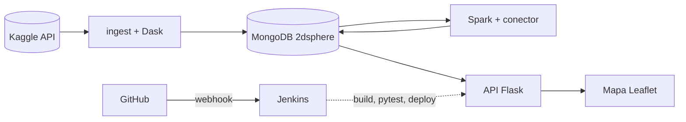

# Informe técnico: procesamiento y consulta de datos geoespaciales con despliegue continuo

**Curso:** Big Data · **Docente:** Andrés Felipe Hernández Marulanda
**Integrantes:** [COMPLETAR]
**Repositorio:** [COMPLETAR URL de GitHub]
**Fecha:** octubre de 2026

> Las partes marcadas con [COMPLETAR] se llenan con los resultados reales del equipo: el reporte de limpieza (`db.ingest_runs`) y el benchmark (`benchmark/results.md`).

## 1. Objetivo

Construir un sistema reproducible que descarga un dataset geoespacial de Kaggle, lo limpia de forma distribuida, lo almacena como GeoJSON en MongoDB, calcula agregaciones espaciales y temporales con Spark, permite consultas por ubicación a través de una API Flask y se despliega automáticamente con Jenkins cada vez que cambia la rama principal del repositorio. Todo corre en contenedores y se levanta con `docker compose up -d --build`.

## 2. Datos

Dataset: *Crimes in Chicago* (Kaggle, `currie32/crimes-in-chicago`), archivo `Chicago_Crimes_2012_to_2017.csv`. Cada registro es un delito reportado a la policía de Chicago, con fecha, tipo (`Primary Type`), descripción, tipo de lugar, si hubo arresto, distrito y coordenadas (latitud y longitud).

| Medida | Valor |
|---|---|
| Registros en el archivo | [COMPLETAR `raw`] |
| Tamaño del CSV | [COMPLETAR] MB |
| Periodo | 2012 – 2017 |
| Registros válidos cargados en MongoDB | [COMPLETAR `documents_in_mongo`] |

## 3. Arquitectura



[Insertar aquí también una captura del diagrama del tablero o de `docker compose ps`.]

Todos los servicios se definen en `docker-compose.yml` y se comunican por la red interna de Compose usando el nombre del servicio como host (`mongo`, `spark-master`, `dask-scheduler`, `api-staging`). Los datos persisten en volúmenes con nombre (`mongo_data`, `data`, `jenkins_home`), de modo que se pueden recrear contenedores sin perder información.

Servicios: MongoDB 7; Spark 3.5.3 en modo standalone (master, worker y un contenedor driver `spark-job`) con MongoDB Spark Connector 10.4; Dask con scheduler y dos workers; API Flask servida con gunicorn; Jenkins LTS con Docker CLI.

## 4. Decisiones técnicas

**Una imagen para todo Dask.** El cliente de ingesta, el scheduler y los workers usan la misma imagen, porque Dask exige que las versiones de Python y librerías coincidan en todos los procesos.

**Conector de Spark resuelto en la construcción.** El conector y sus dependencias (driver de MongoDB y BSON) se descargan al construir la imagen y se copian a `/opt/spark/jars`. Así el master, los workers y el driver tienen los mismos jars y los trabajos no dependen de internet.

**Driver de Spark en su propio contenedor.** `spark-job` envía los trabajos en modo client y anuncia su IP interna (`spark.driver.host`) para que los executors puedan conectarse de vuelta.

**Idempotencia.** El `_id` de cada documento es el ID original del registro y la carga usa `insert_many(ordered=False)`: si la ingesta se repite, los duplicados se descartan sin detener el lote. La ingesta no se repite si la colección ya tiene datos, y Spark no recalcula si sus resultados corresponden a la última ingesta.

**Credenciales.** El token de Kaggle y la clave de Jenkins viven en el archivo `.env` (en `.gitignore`) y en la credencial `kaggle-api` de Jenkins, que el pipeline inyecta con `withCredentials`. MongoDB solo se publica en `127.0.0.1` para usar Compass desde el propio equipo.

**Jenkins como código.** Con Configuration as Code y Job DSL, Jenkins arranca con el usuario, la credencial y el job ya creados, así que el sistema se levanta en otro equipo sin pasos manuales ocultos.

**Despliegue con imagen candidata.** El pipeline construye `geo-api:candidate`, la prueba en un contenedor de staging y solo si todo pasa la retaguea como `geo-api:latest` y recrea la API de producción. Una prueba fallida deja producción intacta.

## 5. Ingesta y limpieza con Dask

El CSV se lee con `dask.dataframe.read_csv` en particiones de 64 MB, todas las columnas como texto para evitar errores de inferencia de tipos entre particiones. Las reglas de limpieza y sus justificaciones:

| Regla | Justificación | Registros descartados |
|---|---|---|
| Latitud o longitud nula o no numérica | Sin coordenadas el registro no se puede ubicar ni indexar | [COMPLETAR `null_coord`] |
| Fuera de rango (lat ±90, lon ±180) | MongoDB rechaza puntos inválidos en un índice 2dsphere | [COMPLETAR `out_of_range`] |
| Fuera del área de estudio (lon −87,96 a −87,50; lat 41,62 a 42,05) | Puntos en (0,0) o en otros estados son errores de georreferenciación y distorsionan la grilla | [COMPLETAR `out_of_bbox`] |
| Fecha no interpretable | Necesaria para el análisis temporal | [COMPLETAR `bad_date`] |
| ID faltante o duplicado | El ID es la clave primaria; un duplicado contaría dos veces el mismo delito | [COMPLETAR `missing_id` + `duplicates`] |
| **Total válido** | | [COMPLETAR `final`] ([COMPLETAR]% del archivo) |

Cada registro válido se transforma en un punto GeoJSON (`{"type": "Point", "coordinates": [lon, lat]}`; el orden de GeoJSON es longitud, latitud), la fecha en `Date` de BSON y los campos booleanos y enteros en sus tipos. Los resultados limpios se guardan en Parquet y cada worker inserta su partición en MongoDB en lotes de 5000 documentos. Tiempos medidos: limpieza [COMPLETAR `clean_seconds`] s, carga [COMPLETAR `load_seconds`] s.

Índices: `location_2dsphere` (consultas espaciales), `date_1` (filtros por fecha) y `category_date` (filtro por tipo y fecha).

## 6. Procesamiento distribuido con Spark

Spark lee la colección `crimes` desde MongoDB, extrae latitud y longitud del arreglo `location.coordinates` y calcula:

- **Grilla espacial** (`agg_grid`): cada punto se asigna a la celda `(floor(lat/g), floor(lon/g))` con g = 0,005° (≈ 550 m × 410 m en la latitud de Chicago). Por celda se guarda el conteo, el polígono GeoJSON, el centro, la densidad por km² (corrigiendo el ancho de la celda por el coseno de la latitud), la tasa de arresto y la categoría más frecuente (ventana `row_number` sobre conteos por categoría).
- **Zonas de alta concentración** (`agg_hotspots`): celdas con conteo mayor o igual al percentil 99 (`approxQuantile`), con su z-score y ranking.
- **Comportamiento temporal** (`agg_temporal`, `agg_category_hour`): conteos por hora, día de la semana, mes y año, y categoría × hora para las 10 categorías más frecuentes.
- **Por categoría** (`agg_types`): conteo, participación y tasa de arresto.

Resultados principales: [COMPLETAR con 3 o 4 hallazgos, por ejemplo: número de celdas con datos, umbral p99, ubicación de los 3 primeros hotspots, hora pico y hora mínima, mes con más registros, categoría más frecuente y su tasa de arresto].

Verificación: la suma de `count` en `agg_grid` coincide con el número de documentos de `crimes`, y un conteo con `$geoWithin` sobre el polígono de un hotspot devuelve el mismo valor que Spark para esa celda. [COMPLETAR con la verificación hecha.]

## 7. Consultas geoespaciales y API

Todas las consultas reciben sus parámetros desde la petición HTTP y los validan (rangos de latitud y longitud, radio entre 1 m y 50 km, polígonos cerrados con vértices válidos).

**Por radio con `$near`** (`GET /api/crimes/near?lat=&lon=&radius=`):

```js
db.crimes.find({ location: { $near: {
  $geometry: { type: "Point", coordinates: [lon, lat] },
  $maxDistance: radius } } }).limit(limit)
```

**Dentro de un polígono con `$geoWithin`** (`POST /api/crimes/within`):

```js
db.crimes.find({ location: { $geoWithin: { $geometry: <Polygon GeoJSON> } } })
```

**Agregación con `$geoNear`** (`GET /api/crimes/summary`): resumen por categoría alrededor de un punto, con distancia promedio y mínima.

```js
db.crimes.aggregate([
  { $geoNear: { near: { type: "Point", coordinates: [lon, lat] },
                distanceField: "distance_m", maxDistance: radius, spherical: true } },
  { $group: { _id: "$category", count: { $sum: 1 },
              avg_distance_m: { $avg: "$distance_m" } } },
  { $sort: { count: -1 } }
])
```

Las tres admiten filtros por categoría, rango de fechas, año y arresto. Los resultados de Spark se exponen en `/api/stats/grid`, `/hotspots`, `/temporal`, `/types` y `/meta`. El mapa Leaflet en `/` permite hacer clic para consultar por radio, dibujar polígonos y ver la grilla y los hotspots.

Tiempos de respuesta medidos (cabecera `X-Response-Time-ms`):

| Consulta | Parámetros | Registros | Tiempo (ms) |
|---|---|---|---|
| `$near` | radio 1 km, límite 200 | [COMPLETAR] | [COMPLETAR] |
| `$geoWithin` | polígono de ~2 km² | [COMPLETAR] | [COMPLETAR] |
| `$geoNear` | radio 1 km | [COMPLETAR] | [COMPLETAR] |

## 8. Integración y despliegue continuo

Flujo: rama de trabajo → pull request → merge a `main` → webhook de GitHub → Jenkins. Etapas del `Jenkinsfile`: checkout, build de imágenes, pruebas unitarias con pytest, levantamiento de servicios, ingesta y Spark (solo cuando hace falta), staging de la imagen candidata, pruebas básicas contra la API y despliegue. Las pruebas unitarias validan parámetros, construcción de consultas y endpoints con una base de datos simulada; las pruebas básicas verifican salud, `$near`, `$geoWithin`, `$geoNear`, resultados de Spark y manejo de errores contra la API real.

Para comprobar que una prueba fallida detiene el despliegue se [COMPLETAR: p. ej. subió un cambio que rompía la validación de latitud; el pipeline falló en "Pruebas unitarias" y producción siguió respondiendo con la versión anterior]. [Insertar captura de la vista de etapas de Jenkins.]

## 9. Comparación Dask frente a Spark

Operación: agregación por grilla sobre los datos limpios en Parquet ([COMPLETAR] registros), tres repeticiones por configuración. Para comparar con los mismos núcleos: configuración A con 2 núcleos (Spark 1 worker × 2 cores; Dask 2 workers × 1 hilo) y B con 4 núcleos (Spark 2 workers × 2 cores; Dask 4 workers × 1 hilo).

| Motor | Config. | 1.ª ejecución (s) | Mediana (s) | Memoria pico total (MB) |
|---|---|---|---|---|
| Spark | A (2 núcleos) | [COMPLETAR] | [COMPLETAR] | [COMPLETAR] |
| Spark | B (4 núcleos) | [COMPLETAR] | [COMPLETAR] | [COMPLETAR] |
| Dask | A (2 núcleos) | [COMPLETAR] | [COMPLETAR] | [COMPLETAR] |
| Dask | B (4 núcleos) | [COMPLETAR] | [COMPLETAR] | [COMPLETAR] |

Memoria: en Dask es el RSS máximo de los procesos worker; en Spark, el RSS de los procesos executor (métricas pico de la API REST del driver). En Spark la cifra incluye la JVM completa, por lo que parte del consumo es fijo y no depende de los datos.

Análisis: [COMPLETAR con lo observado. Guía de qué revisar en los resultados propios:
- ¿Cuánto mejoró cada motor al pasar de 2 a 4 núcleos? Con un archivo de este tamaño, el costo fijo de coordinación puede hacer que la mejora sea menor que el doble.
- ¿Qué tanto pesa el arranque en frío? Spark suele tener una primera ejecución más lenta (JVM, planificación) y estabilizarse después.
- ¿Cuál usó menos memoria por núcleo?
- Conclusión con base en los números: en qué casos conviene cada uno. Por ejemplo, Dask cuando el equipo trabaja en Python y los datos caben en un clúster pequeño, reutilizando código de pandas; Spark cuando el volumen crece, se necesitan conectores como el de MongoDB, o el mismo trabajo debe escalar a un clúster grande con tolerancia a fallos.]

## 10. Conclusiones

[COMPLETAR: 3 a 5 conclusiones: qué se logró, qué fue lo más difícil (por ejemplo, la comunicación entre contenedores o Jenkins), qué mejorarían.]

## Referencias

- Kaggle. *Crimes in Chicago*. https://www.kaggle.com/datasets/currie32/crimes-in-chicago
- MongoDB. *Geospatial Queries* y *$geoNear*. https://www.mongodb.com/docs/manual/geospatial-queries/
- MongoDB. *Spark Connector*. https://www.mongodb.com/docs/spark-connector/current/
- Dask. *Dask DataFrame*. https://docs.dask.org/en/stable/dataframe.html
- Apache Spark. *Spark Standalone Mode* y *Monitoring and Instrumentation*. https://spark.apache.org/docs/3.5.3/
- Jenkins. *Configuration as Code*. https://www.jenkins.io/projects/jcasc/
